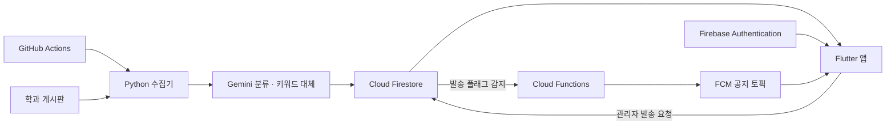

<h1> MY_CSE</h1>

**경상국립대학교 컴퓨터공학부 공지를 한곳에서 카테고리별로 찾고, 필요한 소식을 알림으로 받는 앱서비스**

## Overview

학과 게시판의 학사·장학·취업 공지를 모바일에서 쉽게 찾을 수 있도록 수집, 분류, 열람 흐름을 연결했습니다. Python 수집기가 공지를 Firestore에 저장하고, Flutter 앱이 검색·분류·스크랩 화면을 제공합니다. 일정, 식단, 그룹, 강의실 안내도 같은 앱에서 볼 수 있습니다.

## Features & Demo

| 사용자 흐름 | 구현 |
| --- | --- |
| 공지 모아 보기 | 학과 게시판을 수집하고 제목을 학사·장학·취업·외부행사·학과행사·공모전으로 분류합니다. |
| 필요한 공지 찾기 | 카테고리 탐색, 검색, 중요·긴급·인기 공지, 스크랩을 제공합니다. |
| 소식 전달하기 | 계정 승인과 관리자 공지·행사 관리 화면을 제공합니다. 발송 요청은 FCM을 통해 공지 구독자에게 전달됩니다. |
| 학교생활 정보 보기 | 일정·식단·그룹과 함께 실내 강의실 검색, 층별 경로 안내, 3D 지도 화면을 제공합니다. |

### Demo

<p>
  
  
</p>

**공지 탐색 · 학과 건물 지도** — Google Play에 등록된 앱 화면입니다.

### 핵심 구현

1. **반복 수집에서 상세 페이지를 다시 열 필요를 줄였습니다.** 게시글 ID를 Firestore 문서 ID로 사용합니다. 본문이 이미 있는 문서는 중요·긴급 여부 등 메타데이터만 병합하고, 새 글이나 본문이 빠진 글만 상세 페이지를 수집합니다. [공지 수집기](ai_server/crawler.py)
2. **분류 API가 제한되어도 저장을 이어갑니다.** 수동 분류가 있으면 우선 적용합니다. 나머지는 제목을 Gemini에 보내고 허용된 분류를 추출합니다. 429 응답은 백오프로 재시도하고, 실패하거나 허용된 결과를 얻지 못하면 키워드 규칙으로 분류합니다. [분류기](ai_server/gemini_classifier.py)
3. **지도에서 경로 계산을 분리합니다.** 층별 통로를 인접 리스트로 만들고 BFS로 출발점에서 목적지까지 간선 수가 가장 적은 경로를 구합니다. 부모 노드를 역추적해 화면에 그릴 경로를 복원합니다. [실내 지도](app/lib/features/indoor_map/screens/indoor_map_screen.dart) · [경로 탐색](app/lib/features/indoor_map/services/navigation_service.dart)

## Tech Stack

| 영역 | 기술과 코드 위치 |
| --- | --- |
| 모바일 | Flutter, Dart, Firebase Auth·Firestore·Storage, FCM · [app/lib](app/lib/) |
| 수집·분류 | Python, Selenium, BeautifulSoup, Gemini API · [ai_server](ai_server/) |
| 자동화·알림 | GitHub Actions, Firebase Cloud Functions · [워크플로](.github/workflows/) · [함수](android/functions/) |

### 아키텍처



## How to Run

배포 앱을 설치하려면 [Android·iPhone 다운로드](#앱-다운로드)를 참고하세요.

**모바일 앱**은 Dart 3.10을 지원하는 Flutter SDK, 기기 개발 환경, 개발용 Firebase 프로젝트가 필요합니다. 앱의 Firebase 설정과 대상 플랫폼 설정 파일을 개발용 프로젝트 값으로 구성한 뒤 실행합니다. iOS 빌드에는 macOS와 Xcode가 필요합니다.

```bash
git clone https://github.com/Hyunhoim/MY_CSE.git
cd MY_CSE/app
flutter pub get
flutter run
```

**공지 수집**은 저장소 루트에서 Python 3.11과 Chrome을 준비한 뒤 실행합니다. 활성화한 가상환경에 의존성을 설치하고, `FIREBASE_KEY`에 개발용 서비스 계정 JSON, `GEMINI_API_KEY`에 발급 키를 설정합니다. 수집기는 지정한 Firestore에 직접 씁니다.

```bash
python -m pip install -r ai_server/requirements.txt
python ai_server/crawler.py
```

개발용 Firestore의 `notices` 컬렉션과 앱 공지 목록에서 같은 문서를 확인할 수 있습니다. 긴급 공지 푸시를 확인하려면 Cloud Functions를 배포하고 앱에서 공지 알림을 구독합니다. 예약 수집의 실행 환경과 시크릿 이름은 [공지 수집 워크플로](.github/workflows/crawl.yml)에서 확인할 수 있습니다.

## Appendix

### 앱 다운로드

- **Android** · [Google Play에서 MY_CSE 설치](https://play.google.com/store/apps/details?hl=ko&id=kr.ac.gnu.mycse)
- **iPhone** · [App Store에서 MY_CSE 받기](https://apps.apple.com/kr/app/my-cse/id6758670411)

### 개발 참고

기본 예약 공지 수집은 최근 목록 3페이지를 대상으로 합니다. 분류기는 공지 제목을 기준으로 카테고리를 부여합니다. 실내 BFS 경로는 층별 데이터에서 간선 수를 최소화하며, 물리적 거리 가중치는 적용하지 않습니다.

[원본 프로젝트](https://github.com/kdhun-0814/MY_CSE) · [앱 소스](app/) · [수집 서버](ai_server/)
