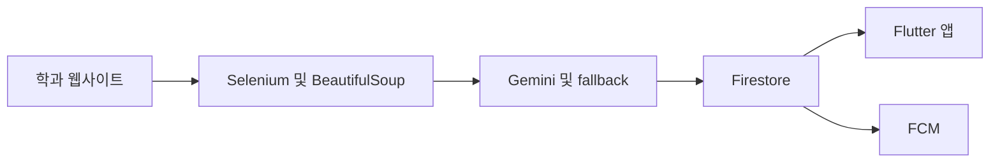

# MY_CSE

**AI 기반 경상국립대학교 컴퓨터공학부 통합 공지 앱**

     

[Overview](#overview) · [Features](#features) · [Architecture](#architecture) · [Documentation](#documentation)

---

## Overview

학과 공지와 대학생활 정보를 통합하는 모바일 팀 프로젝트입니다. 공지 수집 및 생성형 AI 분류를 Firebase 기반 앱에 연결합니다.

## Features

- 학과 웹 공지 수집과 Gemini 자동 분류 및 키워드 fallback
- 공지 검색, 중요·긴급·인기 공지, 스크랩
- 캘린더, 식단, 그룹, 관리자 화면
- Firebase 인증, Firestore, FCM 및 실내·3D 지도 기능

## Architecture

## Tech Stack

Flutter · Dart · Firebase · Python · Gemini · Selenium

## Project Status

팀 프로젝트 개인 보관본입니다. 실행에는 Flutter SDK, Firebase 설정 및 서버 인증 정보가 필요합니다. 앱스토어 배포 상태와 개인 담당 범위는 현재 소스에서 별도로 검증하지 않았습니다.

## Documentation

[원본 팀 저장소](https://github.com/kdhun-0814/MY_CSE) · [앱 문서](app/README.md) · [서버 의존성](ai_server/requirements.txt)

- [상세 개발·실행 안내 및 기존 README](README_DEVELOPMENT.md)
