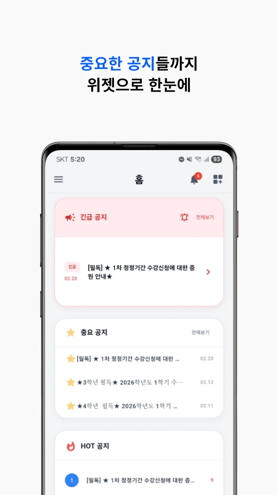
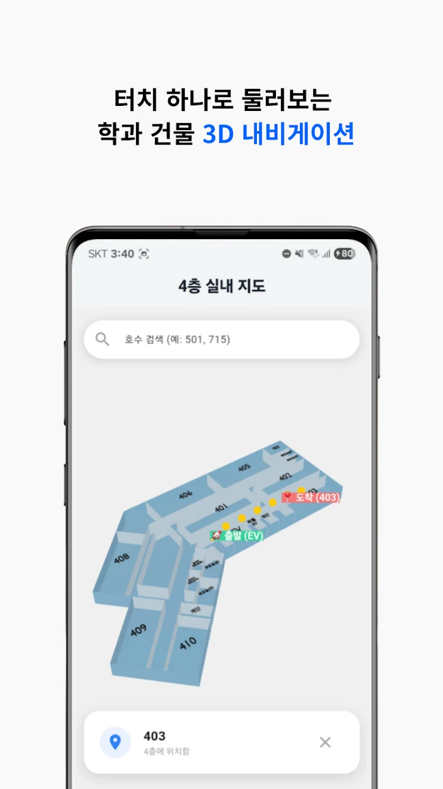
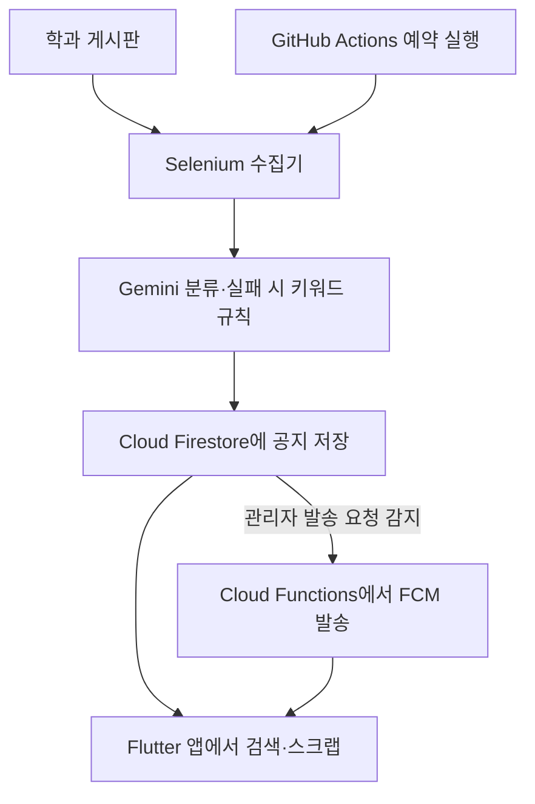

<h1> MY_CSE</h1>

## Overview

MY_CSE는 **경상국립대학교 컴퓨터공학부 학생들이 학과 공지와 대학생활 정보를 한곳에서 확인하는 앱**입니다. 학과 게시판을 수집하고 공지를 학사·장학·취업 등으로 분류해, 필요한 소식을 찾거나 알림으로 받을 수 있게 만들었습니다.

## Features & Demo

### 공지 분류와 알림

수집기가 공지를 Firestore에 저장하면 앱에서 카테고리별로 탐색하고 관심 공지를 스크랩할 수 있습니다. 관리자가 발송을 요청한 공지는 Firebase Cloud Messaging으로 전달됩니다.

<p></p>

*Google Play 배포 페이지에 등록된 공지 화면.*

### 강의실 검색과 3D 안내

601동의 층별 지도를 둘러보고 강의실을 찾을 수 있습니다. 앱에는 학사 캘린더, 식단, 팀원·스터디 모집 화면도 있습니다.

<p></p>

*Google Play 배포 페이지에 등록된 건물 지도 화면.*

## Architecture



## Tech Stack

| 영역 | 기술 |
| --- | --- |
| 모바일 | Flutter, Dart |
| 계정·데이터·알림 | Firebase Authentication, Cloud Firestore, Cloud Functions, Firebase Cloud Messaging |
| 공지 수집·분류 | Python, Selenium, BeautifulSoup, Gemini API |
| 예약 실행 | GitHub Actions |

## How to Run

배포 앱은 [Google Play](https://play.google.com/store/apps/details?hl=ko&id=kr.ac.gnu.mycse)와 [App Store](https://apps.apple.com/kr/app/my-cse/id6758670411)에서 설치할 수 있습니다.

소스에서 실행하려면 Dart 3.10 호환 Flutter SDK와 개발용 Firebase 프로젝트를 준비합니다. Firebase 설정을 개발 프로젝트에 맞춘 뒤 실행합니다. iOS 빌드에는 macOS와 Xcode가 필요합니다.

```bash
git clone https://github.com/Hyunhoim/MY_CSE.git
cd MY_CSE/app
flutter pub get
flutter run
```

공지 수집기는 저장소 루트에서 별도로 실행합니다. Python 3.11과 Chrome을 준비하고, `FIREBASE_KEY`에 개발용 Firebase 서비스 계정 JSON, `GEMINI_API_KEY`에 분류용 키를 설정합니다.

```bash
python -m pip install -r ai_server/requirements.txt
python ai_server/crawler.py
```

## Appendix

- **반복 수집** · 게시글 ID를 문서 ID로 사용합니다. 본문이 이미 저장된 공지는 메타데이터만 갱신하고, 새 글과 본문이 없는 글은 상세 페이지를 수집합니다. [수집기](ai_server/crawler.py)
- **분류 실패 대응** · Gemini에 요청 제한이 걸리면 재시도하고, 유효한 분류를 받지 못하면 키워드 규칙을 적용합니다. [분류기](ai_server/gemini_classifier.py)
- **실내 경로** · 연결된 통로를 인접 리스트로 만들고 BFS로 통과 간선 수가 가장 적은 경로를 계산합니다. [경로 탐색 서비스](app/lib/features/indoor_map/services/navigation_service.dart)
- **프로젝트 출처** · [원본 프로젝트 저장소](https://github.com/kdhun-0814/MY_CSE)
